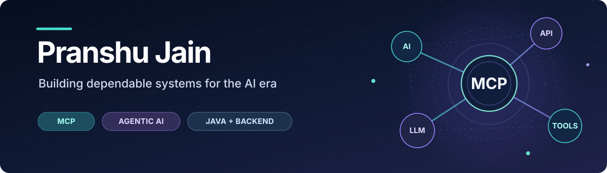

<!-- GitHub Profile README for github.com/pranshuja1n -->

  

  

    
    
    
  

## 👋 Hello, I'm Pranshu

I'm a **Senior Software Engineer at SmartBear** with **7+ years of experience** building, modernizing, and delivering enterprise software. My journey began with **Java and backend engineering**; today, I'm bringing that foundation into **Model Context Protocol (MCP), AI integrations, and agentic developer workflows**.

I enjoy solving complex integration problems, building reliable systems, improving engineering practices, and helping teams grow.

- 🔭 **Currently building:** MCP-powered integrations that connect AI assistants with enterprise tools and workflows.
- 🧠 **Current interests:** Tool discovery and execution, secure integrations, LLM-assisted engineering, agent workflows, and AI evaluation/guardrails.
- 🛠️ **Engineering roots:** Java, Spring Boot, REST APIs, enterprise migrations, architecture, and developer tooling.
- 🤝 **Beyond code:** Engineering mentorship, technical training, collaboration, and delivery leadership.

## 🚀 What I'm working on

### 🧩 MCP & enterprise AI integrations
Designing and developing **Model Context Protocol-based systems** that make enterprise functionality accessible to AI assistants through well-defined tools. Areas of focus include tool interfaces, API orchestration, authentication-aware access, and reliability.

### 🤖 AI-assisted engineering
Applying LLMs to practical engineering problems, including an **AI-powered migration error enrichment system** that helps surface possible root causes and next steps directly in the product experience. I'm also exploring ways to evaluate and safeguard AI-driven tool usage.

### ⚙️ Platform engineering & modernization
Bringing years of Java experience to modernization efforts: **Java 17 → 25**, **Spring Boot 3 → 4**, dependency upgrades, REST API integration, and stronger CI/CD quality checks using **GitHub Actions, unit tests, and JaCoCo**.

> Much of my professional work is on proprietary enterprise products, so I share the problems, architecture areas, and outcomes rather than internal source code.

## 🧰 Technologies & skills

  

| Focus | Tools & concepts |
| :--- | :--- |
| **MCP & applied AI** | Model Context Protocol, AI tool integration, prompt engineering, LLM integration, agent workflows, evaluation & guardrails (exploring) |
| **Languages & backend** | TypeScript, Node.js, Java, Python, SQL, Spring Boot, REST APIs, Jakarta EE |
| **Security & integration** | OAuth 2.0, API authentication, tool-access design, integration patterns |
| **DevOps & quality** | GitHub Actions, CI/CD, Maven, JaCoCo, unit testing, code quality |
| **Architecture & leadership** | System modernization, enterprise data migrations, technical mentoring, Agile delivery |

## 🏆 Career highlights

- 🌍 **10+ international enterprise migrations** across North America, Europe, and Africa, with a **100% successful go-live rate**.
- 👥 **13+ engineers mentored** across teams, including **two Rising Star award recipients**.
- 🧭 **Enterprise delivery leadership:** helped recover critical engagements and protect key customer relationships under demanding timelines.
- 📉 **Quality improvements:** contributed to an approximately **30% reduction in production bugs** through cross-functional and engineering-quality initiatives.
- 🏗️ **Modernization ownership:** drove stack upgrades and introduced automated pull-request quality checks.

## 🎓 Certification

  

**Claude Certified Developer – Foundations** · **Anthropic**

## 📈 GitHub activity

View my GitHub stats

 

  
  

## 🤝 Let's connect

I'm always interested in conversations about **MCP, applied AI, backend architecture, modernization, and engineering leadership**.

  From dependable enterprise systems to intelligent, tool-connected applications.

